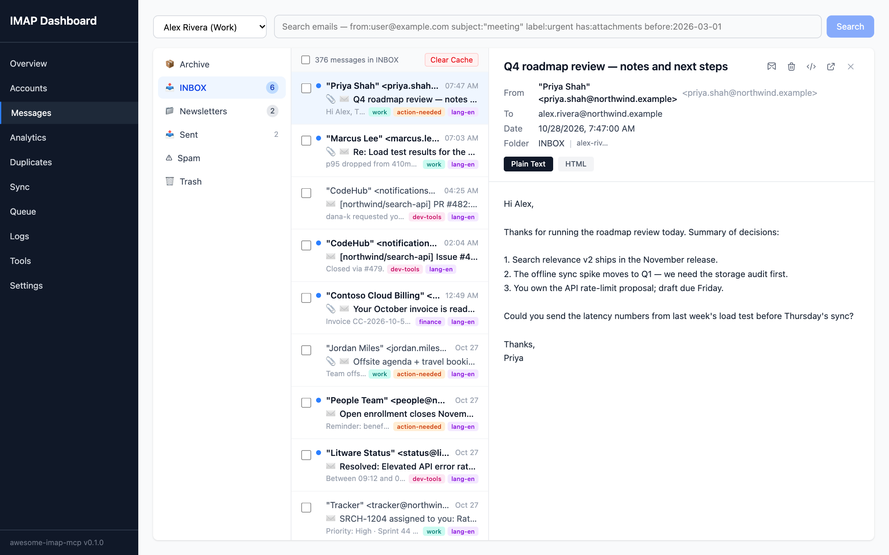
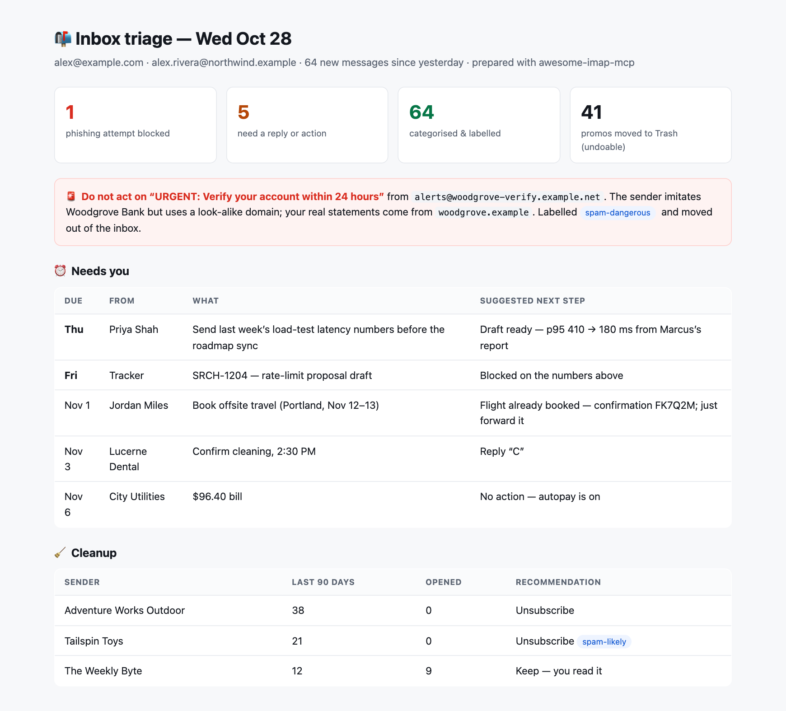
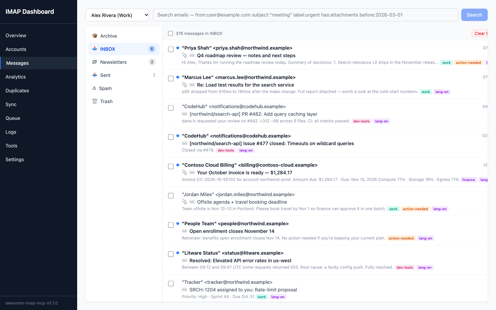
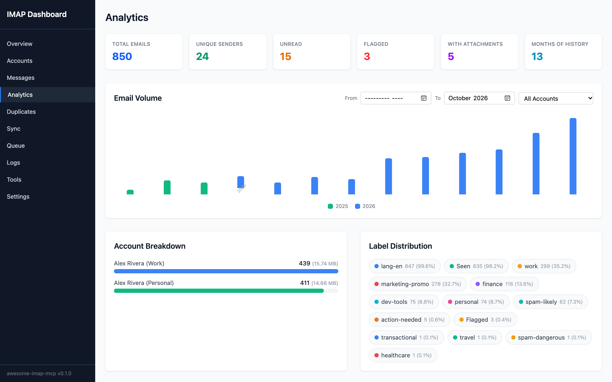
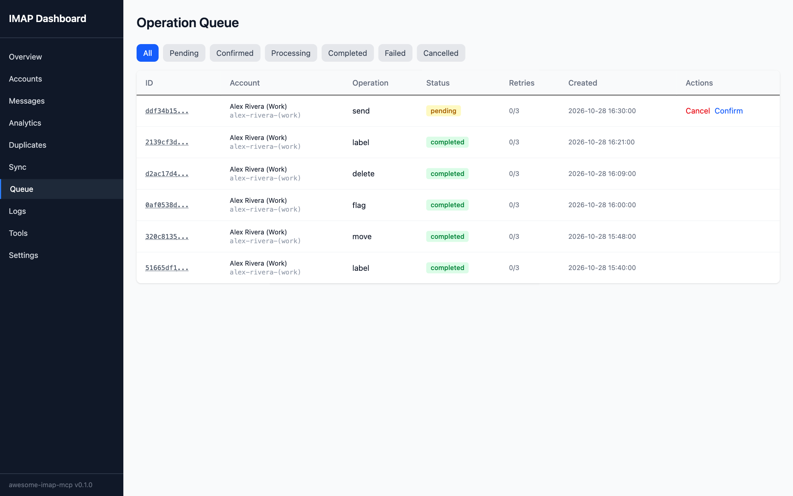
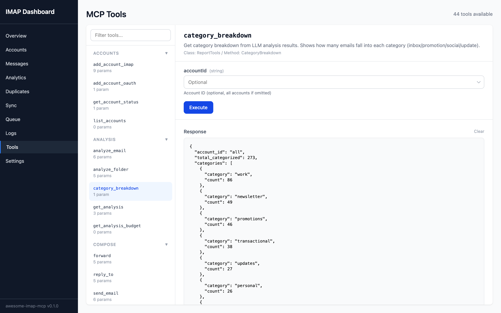
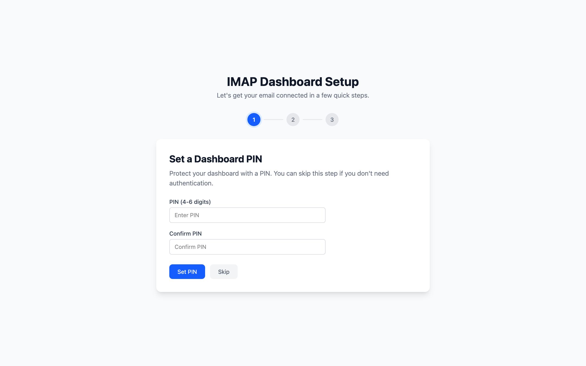

# Awesome IMAP MCP

A batteries-included MCP server for email. Works with any IMAP provider (Gmail, Outlook, Fastmail, ProtonMail, Yahoo, Zoho, self-hosted, etc.).

Unlike every other email MCP server out there, this one has a **local cache**, an **operation queue with undo**, a **web dashboard with setup wizard**, **OAuth2 sign-in**, **LLM-powered email analysis**, and **44 MCP tools** covering search, compose, organize, attachments, labels, duplicates, reports, and more.

Built with **.NET 10** and **MailKit** for maximum performance and cross-platform support.



<sub>All screenshots use an invented demo mailbox — fictional people and companies on reserved `example` domains.</sub>

## See It in Action

Point an agent like Claude at your inbox and ask it to triage. It searches the local cache, reads bodies, labels and files messages through the undoable queue, and hands back something like this:

<p align="center"></p>

> *"Triage everything that arrived since yesterday. Label it, move the promos out, and tell me what actually needs me."*

Everything the agent changed is in the operation queue, and every write can be undone.

## Why This Exists

Every existing IMAP MCP server hits the IMAP server on every single tool call. No caching, no queuing, no UI, no intelligence. This project fixes all of that.

## Key Features

- **OAuth2 sign-in** - one-click sign-in for Gmail, Outlook, and Yahoo via PKCE (no client secrets needed). App passwords also supported for all providers
- **Web dashboard with setup wizard** - guided first-run setup, account management, message browsing with bulk operations, an analytics page (volume charts, top senders, label distribution), editable settings, sync monitoring, queue viewer, duplicate detection, and direct tool execution (parameter autocomplete narrows by context: pick an account and folder to see its messages, or pick a message to see the folders it is in)
- **Local SQLite cache with full-text search** - instant search, no IMAP round-trips
- **IMAP IDLE + polling** - real-time inbox sync, configurable per folder
- **Operation queue** - all writes are queued with priority tiers, retry logic, and undo
- **Send with undo** - emails are queued, not sent immediately. Cancel within a configurable window
- **LLM analysis** - spam scoring, category labeling, priority detection, custom rules (via API, ACP, or in-context)
- **Bulk operations with preview** - query emails by any criteria (including LLM scores), preview results, then execute
- **Mailbox reports** - volume trends, top senders, category breakdown, spam analysis
- **Multi-account** - first-class support for multiple email accounts
- **Thread reconstruction** - groups messages into conversations from headers
- **Attachments** - list, search, inspect, and download attachments across all accounts
- **Labels & keywords** - configurable label vocabulary, local storage fallback for servers without keyword support (Yahoo, etc.)
- **Duplicate detection** - cross-account duplicate detection with selective bulk deletion via queue
- **Provider quirk profiles** - auto-adapts folder names, auth methods, and search capabilities per provider
- **Per-account connection throttling** - configurable max IMAP connections per account (default 5)
- **Token budget awareness** - configurable response sizes so you don't blow context windows
- **Email security** - DOMPurify HTML sanitization, script stripping, remote resource blocking, default plain text view
- **Secure by default** - listens on loopback only, rejects DNS-rebinding requests, verifies installer checksums, and refuses to let an attachment overwrite an existing file unless asked (see [Security](#security))
- **Readable bodies** - when a sender ships a placeholder plain-text part ("undefined", "your client does not support HTML", an invisible preview-text pad), the HTML part is converted instead, so agents see the real content
- **Full observability** - metrics, logs, and tracing (OpenTelemetry export optional)
- **HTTP+SSE transport** - run as stdio (default) or HTTP server for remote MCP clients, or both
- **Multi-instance support** - leader election via heartbeat coordination; primary/secondary proxy architecture
- **Port standby** - multiple instances share a port gracefully; standby processes auto-take over when the primary exits
- **Single-file binaries** - download one file per platform, no runtime dependencies
- **Multiple SQLite databases** - cache.db, health.db, labels.db, metrics.db, logs.db with WAL mode

---

## Installation

### Option 1: Single Binary (no dependencies)

Download a self-contained binary for your platform — no .NET SDK required.

```bash
# One-liner install (Linux/macOS)
curl -fsSL https://raw.githubusercontent.com/shahabmokhtari/awesome-imap-mcp/main/install.sh | bash
```

The installer verifies the download against the release's `SHA256SUMS` before installing and refuses a binary that doesn't match.

Or download manually from the [releases page](https://github.com/shahabmokhtari/awesome-imap-mcp/releases):

| Platform | Binary |
|----------|--------|
| Linux x64 | `awesome-imap-mcp-linux-x64` |
| Linux arm64 | `awesome-imap-mcp-linux-arm64` |
| macOS x64 (Intel) | `awesome-imap-mcp-osx-x64` |
| macOS arm64 (Apple Silicon) | `awesome-imap-mcp-osx-arm64` |
| Windows x64 | `awesome-imap-mcp-win-x64.exe` |
| Windows arm64 | `awesome-imap-mcp-win-arm64.exe` |

```bash
# Verify the download against the published checksums, then make it executable and run
shasum -a 256 -c SHA256SUMS --ignore-missing
chmod +x awesome-imap-mcp-*
./awesome-imap-mcp-osx-arm64 --config ./config.json
```

### Option 2: .NET Global Tool

Requires [.NET 10 SDK](https://dotnet.microsoft.com/download/dotnet/10.0).

```bash
dotnet tool install -g awesome-imap-mcp
```

### Option 3: From Source

```bash
git clone https://github.com/shahabmokhtari/awesome-imap-mcp.git
cd awesome-imap-mcp
dotnet build
```

### Option 4: Docker

```bash
docker build -t awesome-imap-mcp .
docker compose up -d
```

---

## Quick Start

### Option A: Use the Setup Wizard (recommended)

The easiest way to get started is with the dashboard's built-in setup wizard:

```bash
awesome-imap-mcp --dashboard --dashboard-auto-open
```

This opens the dashboard in your browser. The wizard walks you through:
1. Optional PIN protection for the dashboard
2. Adding your first email account (OAuth sign-in or app password)

### Option B: Manual configuration

#### 1. Create a configuration file

```bash
mkdir -p ~/.awesome-imap-mcp
cp config.example.json ~/.awesome-imap-mcp/config.json
```

Edit `~/.awesome-imap-mcp/config.json` with your email account details.

#### 2. Set up authentication

**OAuth2 (Gmail, Outlook, Yahoo)** — Use the dashboard wizard or the OAuth flow in the Accounts page. No manual token management needed.

**App Password (all providers)** — Reference environment variables in config using `${ENV_VAR}` syntax:

```json
{
  "password": "${ACCOUNT_PERSONAL_PASSWORD}"
}
```

```bash
export ACCOUNT_PERSONAL_PASSWORD="your-app-password"
```

#### 3. Run the server

```bash
# With default config (~/.awesome-imap-mcp/config.json)
awesome-imap-mcp

# With dashboard enabled
awesome-imap-mcp --dashboard

# With a specific config file
awesome-imap-mcp --config ./config.json

# HTTP transport for multi-client setups
awesome-imap-mcp --transport both --dashboard
```

#### 4. Run from source

```bash
dotnet run --project src/AwesomeImapMcp.McpServer -- --config ./config.example.json --dashboard
```

#### 5. Run with Docker

```bash
docker run -v ./config.json:/app/config.json -v imap-cache:/data -p 127.0.0.1:3847:3847 awesome-imap-mcp
```

Inside a container, loopback isn't reachable from the host, so set `"bind_address": "0.0.0.0"` in the container's config and publish the port to `127.0.0.1` on the host as shown — that keeps it off your network. Set a dashboard PIN before publishing it anywhere wider.

---

## Adding to MCP Clients

### Claude Code

```bash
claude mcp add awesome-imap-mcp -- awesome-imap-mcp
```

Or with dashboard and HTTP transport for multi-client use:

```bash
claude mcp add awesome-imap-mcp -- awesome-imap-mcp --transport both --dashboard
```

### Claude Desktop

Add to your `claude_desktop_config.json`:

```json
{
  "mcpServers": {
    "awesome-imap-mcp": {
      "command": "awesome-imap-mcp",
      "args": ["--config", "/path/to/config.json"]
    }
  }
}
```

### Cursor

Add to `.cursor/mcp.json` (project) or `~/.cursor/mcp.json` (global):

```json
{
  "mcpServers": {
    "awesome-imap-mcp": {
      "command": "awesome-imap-mcp",
      "args": ["--config", "/path/to/config.json"]
    }
  }
}
```

### Windsurf

Add to `~/.codeium/windsurf/mcp_config.json`:

```json
{
  "mcpServers": {
    "awesome-imap-mcp": {
      "command": "awesome-imap-mcp",
      "args": ["--config", "/path/to/config.json"]
    }
  }
}
```

### HTTP+SSE (any client)

```bash
awesome-imap-mcp --transport http --port 3846
```

Connect your client to `http://127.0.0.1:3846/sse`.

The HTTP transport listens on loopback (`127.0.0.1` and `::1`) only, so other machines on your network can't reach it. It has no authentication of its own — see [Network exposure](#network-exposure) before changing that.

---

## CLI Arguments

| Argument | Description |
|----------|-------------|
| `--config <path>` | Path to config file (default: `~/.awesome-imap-mcp/config.json`) |
| `--port <number>` | Override the HTTP+SSE transport port (default: `3846`) |
| `--dashboard-port <number>` | Override the web dashboard port (default: `3847`) |
| `--transport <mode>` | Override transport mode: `stdio`, `http`, or `both` |
| `--dashboard` | Enable the web dashboard |
| `--dashboard-auto-open` | Enable dashboard and auto-open it in the browser on first launch |

CLI arguments take precedence over values in the config file. You can also set the config path via the `AIMAP_CONFIG_PATH` environment variable.

**Port standby**: If the HTTP or dashboard port is already in use (e.g., another instance is running), the server runs in standby mode and automatically takes over when the port is released. This means multiple MCP clients can each launch their own server process — the first one claims the HTTP port, and the others wait in standby. If the primary goes down, a standby instance takes over seamlessly.

---

## MCP Tools (44)

### Search & Read
| Tool | Description |
|------|-------------|
| `search_emails` | Full-text search with advanced filters (from, to, subject, date range, folder). Searches local cache by default; set `server_search=true` for IMAP server search. Supports `fetchBodies` to auto-fetch bodies inline |
| `list_emails` | Browse a folder sorted by date with pagination. For keyword search, use `search_emails` |
| `get_message` | Get a single message with full body, headers, and attachment list. Auto-fetches body from server if not cached |
| `get_thread` | Get all messages in a conversation thread, ordered by date |

### Compose (all queued with undo)
| Tool | Description |
|------|-------------|
| `send_email` | Compose and send a new email. Queued with configurable undo window. Returns `pending_id` |
| `reply_to` | Reply to an existing email. Supports `reply_all`. Original message automatically quoted |
| `forward` | Forward an email to new recipients with optional preamble text |

### Organize (all queued with undo)
| Tool | Description |
|------|-------------|
| `delete_messages` | Delete one or more messages by UID (moved to trash on most servers) |
| `move_messages` | Move messages between folders (e.g., INBOX to Archive) |
| `mark_read` | Mark messages as read |
| `mark_unread` | Mark messages as unread |
| `flag_messages` | Flag or unflag messages (starred/important marker) |
| `label_messages` | Add or remove a label (IMAP keyword) from messages |

### Attachments
| Tool | Description |
|------|-------------|
| `list_attachments` | List all attachments for a specific message |
| `search_attachments` | Search attachments across all messages with filters (filename, content type, date, size) |
| `get_attachment_info` | Get detailed information about a specific attachment |
| `download_attachment` | Download an attachment from the IMAP server and save to disk. Refuses to replace an existing file unless `overwrite: true` |

### Folders
| Tool | Description |
|------|-------------|
| `list_folders` | List all folders with message counts, unread counts, and sync status |
| `get_folder_stats` | Get detailed statistics for a specific folder |
| `create_folder` | Create a new IMAP folder on the server (supports nested paths) |

### Labels (vocabulary management)
| Tool | Description |
|------|-------------|
| `list_labels` | List the configured label vocabulary with descriptions and categories |
| `add_label` | Add a new label to the vocabulary (must be a valid IMAP keyword) |
| `update_label` | Update a label's description or category |
| `remove_label` | Remove a label from the vocabulary (does not remove from messages) |

### LLM Analysis
| Tool | Description |
|------|-------------|
| `analyze_email` | Analyze a single email: summary, spam_score, category, priority, or custom prompt |
| `analyze_folder` | Batch-analyze emails in a folder (respects daily token budget) |
| `get_analysis` | Retrieve stored LLM analysis results, filtered by account or type |
| `get_analysis_budget` | Check daily token usage and monthly cost against configured limits |

### Reports
| Tool | Description |
|------|-------------|
| `mailbox_report` | Per-folder volume stats, attachment counts, and total storage used |
| `top_senders` | Top email senders ranked by message count |
| `category_breakdown` | Email category distribution from LLM analysis results |

### Batch Operations
| Tool | Description |
|------|-------------|
| `fetch_bodies` | Batch-fetch message bodies for given UIDs (skips already-cached) |
| `detect_duplicates` | Find emails that exist in multiple IMAP accounts (cross-account deduplication) |
| `delete_duplicates` | Delete duplicate emails from a specific account, keeping copies in other accounts. Dry run by default |

### Account Management
| Tool | Description |
|------|-------------|
| `list_accounts` | List all configured email accounts with connection status |
| `get_account_status` | Get detailed status for an account (config, sync progress, folder counts) |
| `add_account_imap` | Add a new IMAP email account (password encrypted before storage) |
| `add_account_oauth` | Start the OAuth2 flow for Gmail, Outlook, or Yahoo (requires dashboard) |
| `start_dashboard` | Get the dashboard URL or status message |

### Sync
| Tool | Description |
|------|-------------|
| `sync_now` | Trigger immediate IMAP sync for one folder or all folders |
| `get_sync_status` | Get real-time sync status for all folders (last sync time, message counts, state) |

### Queue Management
| Tool | Description |
|------|-------------|
| `confirm_send` | Confirm a pending send operation for immediate execution |
| `cancel_operation` | Cancel a pending or confirmed operation before it executes |
| `list_pending` | List all pending and confirmed operations, optionally filtered by account |

---

## Web Dashboard

Enable with `--dashboard` flag or `"dashboard_enabled": true` in config. The dashboard runs on `dashboard_port` (default: 3847).

### Setup Wizard

On first launch (no accounts configured), the dashboard shows a guided setup wizard:

1. **PIN Setup** (optional) — protect the dashboard with a 4-6 digit PIN
2. **Add Account** — select your provider, sign in with OAuth or enter an app password
3. **Done** — server starts syncing immediately

### Screenshots

| | |
|---|---|
|  |  |
| **Messages** — every account and folder, with AI-assigned labels | **Analytics** — volume trends, unread and flagged counts, label mix |
|  |  |
| **Queue** — every write is queued; sends wait in an undo window | **Tools** — run any of the 44 MCP tools by hand |

<p align="center"><br><b>Setup wizard</b> — PIN, account, done</p>

### Dashboard Pages

- **Overview** — account count, sync status, queue summary, system stats
- **Messages** — browse and search emails across all accounts and folders. Features include:
  - Advanced search operators: `from:`, `to:`, `subject:`, `label:`, `has:attachments`, `before:`, `after:`
  - Search result pagination (50 per page, Prev/Next)
  - Multi-select checkboxes with a bulk action bar (delete / move to trash / archive on selected messages)
  - "Delete all search results" with optional move to trash or archive (chunked into 50-UID batches under the hood)
  - Read/unread/delete actions on individual messages
  - Account + folder displayed in the message detail header (so cross-account search results are unambiguous)
  - View full message headers
  - Open messages in a new window
  - HTML email rendering with DOMPurify sanitization, script stripping, and remote image blocking
  - Default plain text view with HTML as an opt-in toggle
  - Label display with color coding
  - Body-cached indicator
  - Keyboard navigation
- **Analytics** — visual mailbox insights and bulk cleanup tools:
  - Summary cards (total messages, unique senders, unread, flagged, with attachments, months of history)
  - Per-month volume chart (CSS bar chart with auto-scroll to most recent, hover dates)
  - Account breakdown (messages per account)
  - Label distribution (counts and percentages)
  - Top senders table with toggle for received/sent/all and time-window filter (last 3 / 6 / 12 / 24 months)
  - Per-row delete dialog with action toggle (Delete / Move to Trash / Move to Archive), chunked into 50-UID batches automatically
- **Accounts** — add (IMAP/OAuth), edit settings (connection limits, sync config, queue settings), test connection, enable/disable, delete accounts. `accounts.json` is watched on disk and changes made by other processes are picked up automatically.
- **Duplicates** — cross-account duplicate detection, selectable copies per duplicate group, bulk delete via queue, page-size selector
- **Queue** — view pending operations with account names, confirm or cancel sends
- **Sync** — per-folder real-time sync status, trigger manual syncs
- **Settings** — edit all configuration in-browser. Changes saved to `config.json` automatically. Also shows cache statistics and lets you clear the cache (see [Clearing the cache](#clearing-the-cache))
- **Tools** — direct MCP tool execution from the dashboard UI
- **Logs** — live log viewer with level filtering

### Dashboard Authentication

| `dashboard_auth` value | Behavior |
|------------------------|----------|
| `null` (default) | Open access — no authentication required |
| `"pin"` | PIN protected — set a PIN on first access, required for all API calls |

Without a PIN, anyone who can reach the dashboard port can use it — fine on the default loopback binding, not fine on a network. Set a PIN before changing `bind_address`.

---

## Configuration

Configuration is loaded from `config.json`. The default path is `~/.awesome-imap-mcp/config.json`. Override with `--config <path>` or `AIMAP_CONFIG_PATH` env var.

All settings can also be edited from the dashboard's **Settings** page — changes are persisted to `config.json` automatically.

See [`config.example.json`](config.example.json) for a full example.

### Server

```json
{
  "server": {
    "transport": "stdio",
    "http_port": 3846,
    "dashboard_port": 3847,
    "bind_address": "localhost",
    "dashboard_enabled": false,
    "dashboard_auth": null,
    "dashboard_auto_open": false,
    "log_level": "Information",
    "log_file": null
  }
}
```

| Field | Default | Description |
|-------|---------|-------------|
| `transport` | `"stdio"` | MCP transport mode: `"stdio"`, `"http"`, or `"both"` |
| `http_port` | `3846` | Port for HTTP+SSE MCP transport (overridable via `--port`) |
| `dashboard_port` | `3847` | Port for the web dashboard (overridable via `--dashboard-port`) |
| `bind_address` | `"localhost"` | Interface the HTTP transport and dashboard listen on. `"localhost"` binds `127.0.0.1` and `::1`; `"0.0.0.0"` or a specific IP exposes them to the network — see [Network exposure](#network-exposure) |
| `dashboard_enabled` | `false` | Enable the web dashboard |
| `dashboard_auth` | `null` | Dashboard auth mode: `"pin"` (requires PIN) or `null` (open access) |
| `dashboard_auto_open` | `false` | Automatically open dashboard in browser on first launch |
| `log_level` | `"Information"` | Minimum log level: `Trace`, `Debug`, `Information`, `Warning`, `Error`, `Critical` |
| `log_file` | `null` | Path to a log file (in addition to stderr) |
| `log_protocol` | `false` | Record raw MCP stdio traffic to the log directory. ⚠️ This captures **everything** — message bodies and any password passed to `add_account_imap`. Debugging only |

#### Network exposure

The MCP HTTP transport executes mail operations — read, send, delete — and **has no authentication**. By default it only accepts connections from this machine, and rejects any request whose `Host` header isn't `localhost`, `127.0.0.1` or `[::1]`, which blocks DNS-rebinding attacks from web pages you visit.

Setting `bind_address` to `"0.0.0.0"` or a LAN address lets **anyone on that network** operate your mailbox. The server logs a warning at startup when you do. Only do it on a network you control, and prefer an SSH tunnel or a reverse proxy that adds authentication.

### Accounts

```json
{
  "accounts": [
    {
      "name": "my-gmail",
      "imap_host": "imap.gmail.com",
      "imap_port": 993,
      "smtp_host": "smtp.gmail.com",
      "smtp_port": 465,
      "smtp_use_ssl": true,
      "username": "user@example.com",
      "auth_type": "app_password",
      "password": "${ACCOUNT_PERSONAL_PASSWORD}",
      "provider": "gmail",
      "confirm_mode": "implicit",
      "undo_window_seconds": 10,
      "sync": {
        "max_connections": 5,
        "idle_folders": ["INBOX"],
        "poll_interval": 300,
        "max_messages_per_sync": 500,
        "folders": [
          { "path": "INBOX", "cache_window_days": 60 },
          { "path": "[Gmail]/Sent Mail", "cache_window_days": 14 }
        ]
      }
    }
  ]
}
```

| Field | Default | Description |
|-------|---------|-------------|
| `name` | - | Unique name for this account (used in tool calls) |
| `imap_host` | - | IMAP server hostname |
| `imap_port` | `993` | IMAP server port |
| `smtp_host` | - | SMTP server hostname |
| `smtp_port` | `587` | SMTP server port |
| `smtp_use_ssl` | `false` | Use SSL for SMTP connection |
| `username` | - | Email account username |
| `auth_type` | `"app_password"` | Auth method: `"app_password"` or `"oauth2"` |
| `password` | - | Password or `${ENV_VAR}` reference (for app_password auth) |
| `provider` | `"generic"` | Provider profile: `"gmail"`, `"outlook"`, `"fastmail"`, `"protonmail"`, `"yahoo"`, `"zoho"`, `"icloud"`, `"generic"` |
| `confirm_mode` | `"implicit"` | Send confirmation: `"implicit"` (auto-send after delay) or `"explicit"` (wait for confirm) |
| `undo_window_seconds` | `10` | Seconds before implicit sends execute |

#### Per-Account Sync Settings

| Field | Default | Description |
|-------|---------|-------------|
| `sync.max_connections` | `5` | Maximum concurrent IMAP connections for this account |
| `sync.idle_folders` | `["INBOX"]` | Folders to monitor with IMAP IDLE for real-time updates |
| `sync.poll_interval` | `300` | Seconds between poll-based syncs for non-IDLE folders |
| `sync.max_messages_per_sync` | `500` | Maximum messages to sync per cycle |
| `sync.folders` | - | Per-folder sync configuration with `path` and `cache_window_days` |

#### Per-Account Queue Settings

| Field | Default | Description |
|-------|---------|-------------|
| `confirm_mode` | `"implicit"` | `"implicit"` auto-sends after undo window; `"explicit"` waits for `confirm_send` |
| `undo_window_seconds` | `10` | Seconds to wait before executing implicit sends |

#### Authentication Methods

**OAuth2 (recommended for Gmail, Outlook, Yahoo)**: Use the dashboard to sign in with your email provider. The server handles token exchange and automatic refresh via PKCE — no client secrets or manual token management needed. Built-in OAuth client IDs are provided for Gmail and Outlook.

**App Password (all providers)**: Generate an app-specific password from your email provider and set it in the config. Required for providers that don't support OAuth (iCloud, Fastmail, Zoho, ProtonMail via Bridge).

#### Provider-Specific Setup

**Gmail**: OAuth sign-in via dashboard, or use an [App Password](https://support.google.com/accounts/answer/185833). Set `provider: "gmail"`.

**Outlook/Hotmail/Live.com**: OAuth sign-in via dashboard, or use an [App Password](https://support.microsoft.com/en-us/account-billing/using-app-passwords-with-apps-that-don-t-support-two-step-verification-5896ed9b-4263-e681-128a-a6f2979a7944). Set `provider: "outlook"`.

**Zoho**: Use an [App Password](https://www.zoho.com/mail/help/adminconsole/two-factor-authentication.html). Set `provider: "zoho"`.

**Yahoo**: OAuth sign-in via dashboard, or use an [App Password](https://help.yahoo.com/kb/generate-manage-third-party-passwords-sln15241.html). Set `provider: "yahoo"`.

**Fastmail**: Use an [App Password](https://www.fastmail.help/hc/en-us/articles/360058752854). Set `provider: "fastmail"`.

**ProtonMail**: Requires [ProtonMail Bridge](https://proton.me/mail/bridge) + app password. Set `provider: "protonmail"`.

**iCloud**: Use an [App-Specific Password](https://support.apple.com/en-us/102654). Set `provider: "icloud"`.

### OAuth Providers

Override or add OAuth client IDs for providers. Built-in client IDs are provided for Gmail and Outlook. You can override them or add your own providers:

```json
{
  "oauth_providers": {
    "gmail": {
      "client_id": "your-google-client-id.apps.googleusercontent.com"
    },
    "outlook": {
      "client_id": "your-azure-app-client-id"
    },
    "custom_provider": {
      "client_id": "your-client-id",
      "client_secret": "your-client-secret",
      "auth_url": "https://provider.com/oauth/authorize",
      "token_url": "https://provider.com/oauth/token",
      "scopes": ["imap", "smtp"]
    }
  }
}
```

| Field | Description |
|-------|-------------|
| `client_id` | OAuth client ID (required) |
| `client_secret` | OAuth client secret (optional, not needed for PKCE public clients) |
| `auth_url` | Authorization endpoint (overrides built-in default) |
| `token_url` | Token exchange endpoint (overrides built-in default) |
| `scopes` | OAuth scopes (overrides built-in default) |

### Cache

```json
{
  "cache": {
    "db_path": "~/.awesome-imap-mcp/cache.db",
    "max_size_mb": 500,
    "default_window_days": 0,
    "max_body_age_days": 0,
    "imap_fallback_ttl_hours": 1
  }
}
```

| Field | Default | Description |
|-------|---------|-------------|
| `db_path` | `"~/.awesome-imap-mcp/cache.db"` | Path to the SQLite database |
| `max_size_mb` | `500` | Maximum cache size in MB |
| `default_window_days` | `0` | Default number of days to cache (0 = unlimited) |
| `max_body_age_days` | `0` | Auto-evict message bodies older than N days (0 = keep forever) |
| `imap_fallback_ttl_hours` | `1` | Hours before a cache miss triggers IMAP fallback |
| `deleted_retention_days` | `30` | Days a message deleted on the server stays in the cache (hidden) before it is purged |

When a message leaves the cache — trimmed for size or age, purged after deletion, or cleared — its folder links, attachment records, AI analysis and search-index entry go with it. Local labels (kept for accounts without IMAP keyword support) are removed only when the message is purged after being deleted on the server; trimming or clearing the cache keeps them, because that mail still exists. Attachment files you downloaded with `download_attachment` are yours and are never deleted.

#### Clearing the cache

The cache can be cleared from the dashboard: **Settings → Cache Management** (everything, or one account) and the **Clear Cache** button above a folder's message list on the **Messages** page. The same actions are available over the dashboard API:

| Endpoint | What it does |
|----------|--------------|
| `DELETE /api/cache` | Deletes every cached message with its folder links, attachment records and LLM analysis, resets every folder's sync cursor, and starts a background re-sync. The server keeps running. Returns `{ deleted, resync, message }`. |
| `DELETE /api/cache/{accountId}` | The same for one account; only that account is re-synced. Other accounts keep syncing. |
| `DELETE /api/cache/{accountId}/{folderId}` | Takes one folder out of the cache and re-syncs just that folder. A message that is also cached in another folder only loses its link to this folder; it is deleted only when no folder holds it any more. Returns `{ deleted, removedFromFolder, resync, message }`. |
| `DELETE /api/cache?mode=reset-db` | Last resort for a broken database: deletes `cache.db` (and its WAL/SHM files) and **stops the server**, which must then be restarted. |

The three clear actions remove cached mail only. Mail on the server is never touched, and they keep accounts, folders and their per-folder settings, labels, **pending queued writes**, LLM rules, LLM usage history and dashboard sessions. If sync is stopped, or turned off with `sync.enabled: false`, nothing is re-downloaded until you resume or sync manually; the response says so (`resync: false`).

`mode=reset-db` deletes everything in `cache.db`: pending queued writes that have not reached the server yet (moves, flags, labels, deletes, scheduled sends), LLM analysis results, LLM usage history and rules, sync history and dashboard sessions. Labels kept in `labels.db`, metrics, logs and `accounts.json` are separate files and survive.

### Queue

```json
{
  "queue": {
    "p0_flush_interval": 2,
    "p1_flush_interval": 30,
    "p2_flush_interval": 300,
    "send_undo_window": 10,
    "max_retries": 3
  }
}
```

| Field | Default | Description |
|-------|---------|-------------|
| `p0_flush_interval` | `2` | Seconds between P0 (critical) queue flushes |
| `p1_flush_interval` | `30` | Seconds between P1 (normal) queue flushes |
| `p2_flush_interval` | `300` | Seconds between P2 (bulk) queue flushes |
| `send_undo_window` | `10` | Seconds before queued sends execute (undo window) |
| `max_retries` | `3` | Maximum retry attempts for failed operations |

### LLM Analysis

```json
{
  "llm": {
    "enabled": false,
    "provider": "anthropic",
    "model": "claude-haiku-4-5-20251001",
    "api_key_env": "ANTHROPIC_API_KEY",
    "daily_token_budget": 1000000,
    "monthly_cost_limit": 5.00,
    "auto_analyze_new": false
  }
}
```

| Field | Default | Description |
|-------|---------|-------------|
| `enabled` | `false` | Enable LLM-powered email analysis |
| `provider` | `"openai"` | LLM provider: `"anthropic"`, `"openai"`, `"acp_claude"`, `"acp_copilot"`, `"in_context"` |
| `model` | `"gpt-4o-mini"` | Model name for the chosen provider |
| `api_key_env` | - | Environment variable name containing the API key |
| `daily_token_budget` | `0` | Maximum tokens per day (0 = unlimited) |
| `monthly_cost_limit` | `0` | Maximum monthly cost in USD (0 = unlimited) |
| `auto_analyze_new` | `false` | Automatically analyze newly synced emails |

### Labels

```json
{
  "labels": {
    "allow_cli_edits": true,
    "items": [
      { "name": "Important", "description": "High-priority messages", "category": "Priority" },
      { "name": "Follow-Up", "description": "Needs a response", "category": "Status" }
    ]
  }
}
```

| Field | Default | Description |
|-------|---------|-------------|
| `allow_cli_edits` | `true` | Allow MCP tools to add/update/remove labels |
| `items` | `[]` | List of label definitions with `name`, `description`, and `category` |

Labels are stored as IMAP keywords where supported. For providers without keyword support (e.g., Yahoo), labels are stored locally in `labels.db`.

### Metrics

```json
{
  "metrics": {
    "enabled": false,
    "port": 9090,
    "path": "/metrics",
    "internal_retention_days": 7,
    "otlp_endpoint": null,
    "otlp_protocol": "grpc",
    "export_interval_seconds": 15
  }
}
```

| Field | Default | Description |
|-------|---------|-------------|
| `enabled` | `false` | Enable the Prometheus metrics endpoint |
| `port` | `9090` | Metrics endpoint port |
| `path` | `"/metrics"` | Metrics endpoint path |
| `internal_retention_days` | `7` | Days to retain internal metrics in SQLite |
| `otlp_endpoint` | `null` | OpenTelemetry collector endpoint |
| `otlp_protocol` | `"grpc"` | OTLP protocol: `"grpc"` or `"http"` |
| `export_interval_seconds` | `15` | Seconds between metric exports |

---

## Architecture

```
Claude / MCP Client
    |
    v
[MCP Server] -- stdio or HTTP+SSE
    |
    +-- SearchTools, ComposeTools, OrganizeTools, AttachmentTools, ...  (44 tools)
    |
    +-- [Core]
    |     +-- SQLite (cache.db, health.db, labels.db, metrics.db, logs.db) + FTS5
    |     +-- CredentialEncryptor
    |     +-- ProviderProfileRegistry
    |     +-- OAuth (PKCE token service, auto-refresh)
    |     +-- Leader election + heartbeat coordination
    |
    +-- [ImapClient]
    |     +-- MailKit IMAP/SMTP (password + OAuth2 SASL)
    |     +-- SyncManager (IDLE + polling)
    |     +-- Per-account connection throttling (configurable max_connections)
    |
    +-- [Queue]
    |     +-- QueueManager (P0/P1/P2 priorities)
    |     +-- Send/Delete/Move/Flag/Label executors
    |
    +-- [LLM]
    |     +-- API (OpenAI/Anthropic) / ACP (Claude, Copilot) / InContext
    |     +-- BudgetTracker (daily tokens + monthly cost)
    |
    +-- [Dashboard]
          +-- Kestrel + React SPA (Vite + TailwindCSS)
          +-- SignalR real-time updates
          +-- OAuth callback handler
          +-- Setup wizard
          +-- Email security (DOMPurify, script stripping, remote resource blocking)
```

### Key Design Decisions

- **Cache is just a cache** — all write operations go through the IMAP server via the operation queue. The SQLite database is a local cache only.
- **Messages are deduplicated** across folders via the `message_folders` junction table. A message with copies in INBOX and Archive has one `messages` row and two `message_folders` rows.
- **Sync boundaries** are derived from actual DB data (`GetMaxUid`/`GetMinUid`), not stored columns, ensuring consistency.
- **Queue-based writes** — all CRUD operations (send, delete, move, flag, label) are enqueued with priority tiers (P0 critical, P1 normal, P2 bulk) and support undo/cancel before execution.

## Claude Code Plugin

This repository includes a [Claude Code plugin](https://docs.anthropic.com/en/docs/claude-code/plugins) with skills for email management. The plugin teaches Claude how to effectively use the MCP tools.

### Installation

Add this repository as a plugin source in Claude Code:

```bash
claude plugin add https://github.com/shahabmokhtari/awesome-imap-mcp
```

Or reference the plugin directory directly if you've cloned the repo:

```bash
claude plugin add /path/to/awesome-imap-mcp/plugin
```

### Included Skills

| Skill | Description |
|-------|-------------|
| `email-analysis` | Analyze, categorize, and report on emails using LLM analysis and statistical tools |
| `email-search` | Search emails with advanced filters — from, to, subject, date, labels, attachments |
| `email-management` | Manage emails — send, reply, forward, delete, move, flag, organize, and bulk operations |

### Plugin Structure

```
plugin/
├── plugin.json              # Plugin manifest
└── skills/
    ├── email-analysis.md    # LLM analysis, labeling, reports workflow
    ├── email-search.md      # Advanced search operators and examples
    └── email-management.md  # CRUD operations, queue, sync, accounts
```

### Usage Examples

Once the plugin is installed, Claude Code can use the skills automatically:

```
> Analyze my inbox and categorize the last 50 emails
  (uses email-analysis skill → analyze_folder + label_messages)

> Find all emails from boss@company.com with attachments since March
  (uses email-search skill → search_emails with from: and has:attachments)

> Delete all duplicate emails from my Yahoo account
  (uses email-management skill → detect_duplicates + delete_messages)
```

## Documentation

- [Design Specification](docs/superpowers/specs/2026-03-18-awesome-imap-mcp-design.md) - full system design, architecture, and implementation plan
- [Data Model](docs/DATA_MODEL.md) - SQLite schema and indexes
- [Security Policy](SECURITY.md) - reporting vulnerabilities, threat model, data handling

## Migrating from `ultimate-imap-mcp`

This project was renamed from `ultimate-imap-mcp` to `awesome-imap-mcp`. If you were using the old name:

1. **Move your data directory** (one-line):
   ```bash
   mv ~/.ultimate-imap-mcp ~/.awesome-imap-mcp
   ```
   This preserves `accounts.json`, all SQLite caches (`cache.db`, `health.db`, `labels.db`, `metrics.db`, `logs.db`), and the `logs/` folder.
2. **Rename environment variables**: `UIMAP_CONFIG_PATH` → `AIMAP_CONFIG_PATH`, `UIMAP_PASSPHRASE` → `AIMAP_PASSPHRASE`.
3. **Update the binary name** in any wrapper scripts: `ultimate-imap-mcp` → `awesome-imap-mcp`.
4. **Reinstall** via `dotnet tool install -g awesome-imap-mcp` or `curl -fsSL https://raw.githubusercontent.com/shahabmokhtari/awesome-imap-mcp/main/install.sh | bash`.
5. **Update MCP client configs** to point at the new command name.

The old GitHub URL `github.com/shahabmokhtari/ultimate-imap-mcp` redirects to the new one, but it's worth updating any pinned references.

## Security

- **Network:** loopback-only by default, with Host-header filtering against DNS rebinding. Opting into wider access is explicit and logged — see [Network exposure](#network-exposure).
- **Credentials:** account passwords and OAuth tokens are stored in `accounts.json` encrypted with AES-256-GCM. The key is derived (PBKDF2, 100,000 iterations) from `AIMAP_PASSPHRASE` if set, otherwise from this machine's ID — set a passphrase if the data directory could be copied elsewhere.
- **Untrusted mail:** HTML is sanitized with DOMPurify and rendered in a sandboxed iframe with no access to the dashboard. Remote images are blocked by default.
- **Agent safety:** writes go through the operation queue and can be undone; sends wait in an undo window or require confirmation. `download_attachment` refuses to replace existing files unless `overwrite: true`, so a prompt-injected email can't overwrite your shell profile.
- **Supply chain:** release binaries ship with `SHA256SUMS`, which the installer enforces. CI fails on any known-vulnerable NuGet package, and runs with a read-only token.

Report vulnerabilities privately — see [SECURITY.md](SECURITY.md).

## License

MIT
